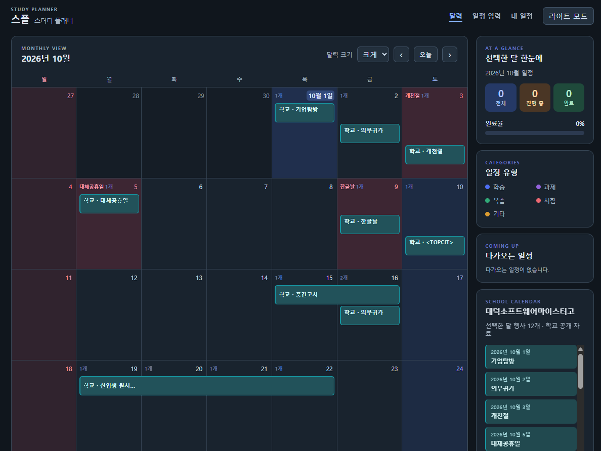
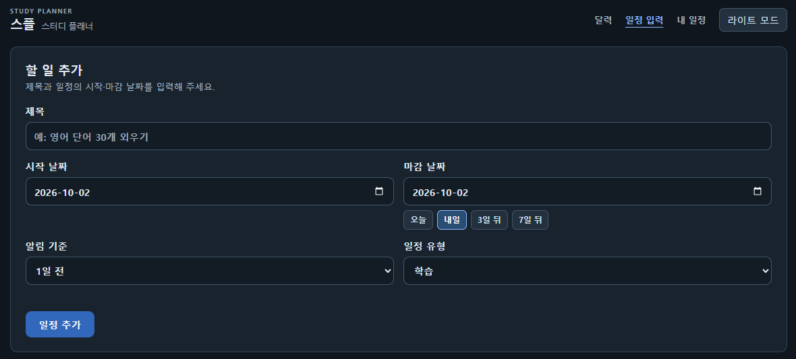
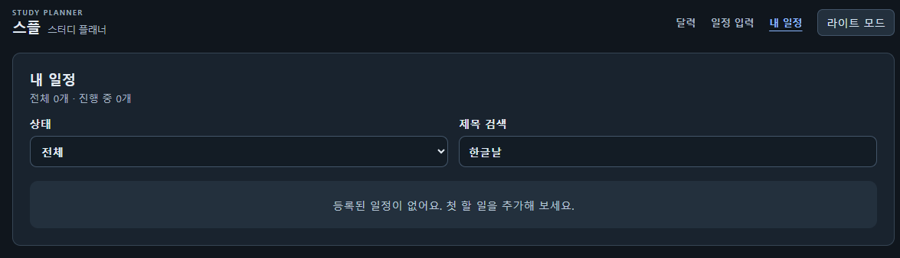

# 1. 앱 이름과 한 줄 소개

**스플(스터디 플래너)**은 학습 일정과 마감일을 한눈에 보는 앱입니다.

## 처음 사용하는 분께

[Windows 사용 방법](docs/user-guide.md)에서 설치, 웹 실행, Lively 배경화면 등록, 기존 일정 옮기기와 문제 해결을 순서대로 확인하세요.

- **웹만 사용:** [GitHub Pages](https://vikira12.github.io/study_plan/)에서 이용합니다. 배경화면과 개인 일정이 자동으로 공유되지는 않습니다.
- **웹과 배경화면 함께 사용:** 로컬 서버 또는 Windows 설치판을 사용하고, 일정은 `http://127.0.0.1:3000/`에서 수정합니다.
- **설치 ZIP 배포 상태:** 아직 GitHub Release에 설치 ZIP을 공개하지 않았습니다. 제작자는 [Windows 배포 안내](docs/windows-distribution.md)에 따라 최신 소스로 ZIP을 생성·검증한 뒤 전달하세요. 이전에 만든 로컬 ZIP은 최신 저장 보호 수정 반영을 위해 다시 만들어야 합니다.

## 2. 누구를 위한 앱인가

학습 일정과 개인 할 일을 혼자 관리하고 싶은 사람을 위한 앱입니다.

## 3. 할 수 있는 일

- 일정의 제목, 시작 날짜, 마감 날짜, 알림 기준을 정해 추가하고 수정할 수 있습니다.
- 달력과 목록에서 일정을 보고, 완료 표시하거나 삭제할 수 있습니다.
- 남은 일수와 마감 임박·기한 경과 상태를 볼 수 있습니다.
- 상태별로 목록을 걸러 보고 제목을 검색할 수 있습니다.
- 새로고침하거나 같은 브라우저에서 다시 열어도 일정이 남습니다.
- 달력 옆의 `학교 급식표`에서 날짜를 선택해 대덕소프트웨어마이스터고의 조식·중식·석식과 칼로리를 봅니다. 배경화면 달력에는 오늘 급식이 함께 표시됩니다.

## 4. 사용 방법

1. `일정 입력`에서 제목과 날짜를 적고 `일정 추가`를 누릅니다.
2. `내 일정`에서 완료한 일정의 체크박스를 누릅니다. 다시 누르면 진행 중으로 돌아갑니다.
3. 필요 없는 일정은 `삭제` 버튼을 누릅니다.

## 5. 실행 방법

[배포된 스터디 플래너](https://vikira12.github.io/study_plan/)를 브라우저로 엽니다. 실시간 공개 일정을 로컬에서 보려면 `node server.js`를 실행하고 `http://127.0.0.1:3000`으로 접속합니다.

## 6. 확인 방법

자세한 순서는 [회귀 점검표](docs/checklist.md)에 있습니다. 일정 추가(①), 완료 표시(②), 삭제(③), 새로고침 뒤 유지(⑤-1·⑤-2)를 확인합니다.

## 7. 데이터 저장 안내

배포 주소와 직접 연 파일의 개인 일정은 브라우저의 `localStorage`에 저장됩니다. 로컬 웹(`node server.js`)은 같은 PC의 개인 일정 파일을 공유하므로 다른 브라우저와 읽기 전용 배경화면에서도 같은 일정을 볼 수 있습니다. 배포 주소의 기존 일정은 **내 일정 → 개인 일정 내보내기/가져오기**로 옮깁니다. 로컬 웹과 배포 주소는 자동으로 동기화되지 않습니다. 공휴일과 대덕소프트웨어마이스터고등학교 공개 일정의 중요한 날짜는 [학교 원본](https://dsmhs.djsch.kr/scheduleH/list.do?m=0203&s=dsmhs)과 대조하세요.

## Windows 배경화면 달력

다른 사람에게 모든 기능을 전달하려면 **Windows 설치 ZIP**을 사용합니다. ZIP에는 공식 Node.js 런타임이 포함되어 별도 Node.js 설치가 필요 없으며, 개인 데이터는 포함하지 않습니다. 압축을 풀어 `설치.cmd`를 실행하면 사용자 전용 설치 폴더, 바탕화면 바로가기, 서버 자동 시작을 구성합니다. Lively 설치와 배경화면 등록은 처음 한 번 직접 진행합니다. 제작·배포·검증 방법은 [Windows 배포 안내](docs/windows-distribution.md)를 참고하세요.

소스로 실행하는 경우 Windows 로그인 시 로컬 서버를 자동 실행하려면 프로젝트 폴더에서 `powershell.exe -NoProfile -ExecutionPolicy Bypass -File .\scripts\install-windows-startup.ps1`을 한 번 실행하세요. 설치 ZIP을 사용하면 설치 과정에서 등록합니다. 실행·해제 방법은 아래 사용 안내에 있습니다.

로컬 서버를 실행한 뒤 Lively Wallpaper에 `http://127.0.0.1:3000/wallpaper.html`을 등록하면 개인 일정과 학교 일정이 함께 표시됩니다. 달력 상단을 드래그해 위치를 옮기고 테두리·모서리를 드래그해 크기를 조절할 수 있습니다. 배치 잠금·초기화와 다시 실행할 때의 배치 복원을 지원합니다. 개인 일정은 15초마다 갱신되며 수정은 로컬 웹에서 합니다. 설치, 일정 이전, 저장 위치와 확인 방법은 [배경화면 달력 안내](docs/desktop-calendar.md)를 참고하세요.

## 8. 만든 과정

- **프롬프트 엔지니어링:** 기획서의 기능과 완료 기준을 구체적인 요청으로 적었습니다.
- **하네스 엔지니어링:** `AGENTS.md`와 점검표에 작업 규칙과 확인 방법을 정했습니다.
- **루프 엔지니어링:** `loop-log.md`에 실패, 수정, 재확인 상태를 기록했습니다.

## 9. 배포 주소

https://vikira12.github.io/study_plan/

## 10. AI 활용 표시

Codex의 도움을 받아 만들었고, 사람이 검증했습니다.

## 알려진 문제

GitHub Pages의 학교·공휴일 정보는 배포 작업에서 생성한 시점의 자료이며 실시간 조회가 아닙니다. 브라우저를 닫은 동안 마감 알림은 전송되지 않습니다.

급식표는 [나이스 공식 급식 자료](https://open.neis.go.kr/portal/data/service/selectServicePage.do?infId=OPEN17320190722180924242823&infSeq=2)를 사용합니다. 로컬 서버는 날짜별로 조회하고 30분간 캐시합니다. Pages는 매일 배포할 때 이전·이번·다음 달 자료를 생성합니다. `node scripts/build-meals.js`로 급식 스냅샷만 갱신할 수도 있습니다. 식단 미등록, 배포 범위 밖, 연결 실패는 서로 다른 안내로 표시합니다. 변경된 메뉴와 알레르기 표시는 [학교 식단 원본](https://dsmhs.djsch.kr/sFoodList.do?m=020502&s=dsmhs)을 확인하세요. 파일을 직접 여는 방식에서는 급식 조회를 지원하지 않습니다.

급식·배경화면·개인 일정 저장 자동 검증: `node --test tests/*.test.js`.

## 화면 미리보기

화면 설명은 [스크린샷 기록](docs/ui-screenshots.md)에서 볼 수 있습니다.
